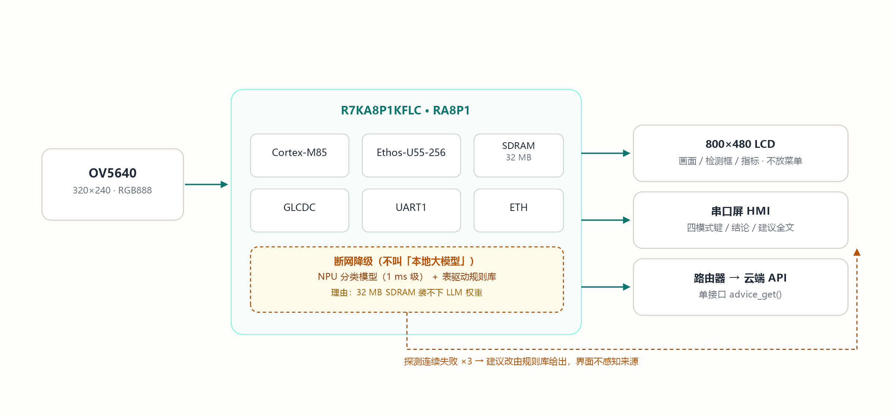
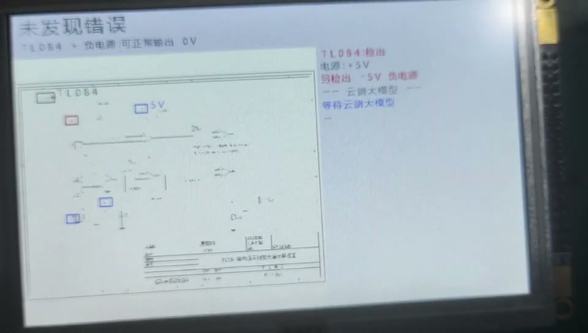
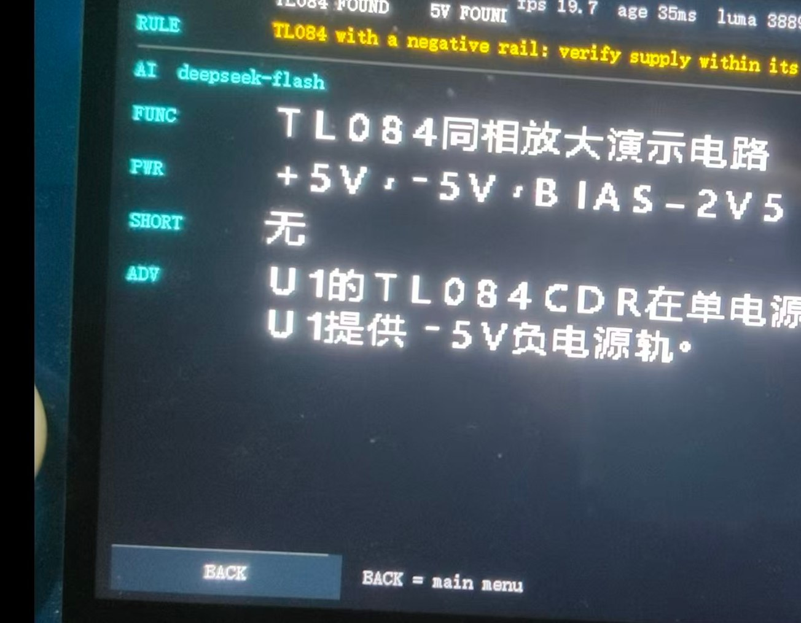
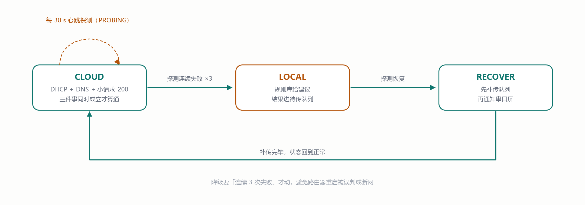

# Titan Mini PCB Inspector

**A dual-screen PCB inspection device on RT-Thread** — camera looks at the board, an 800×480 LCD shows the live picture, a serial HMI panel carries the interaction, an Ethos-U55 NPU does local inference, and the cloud LLM writes the advice. Works offline too: when the network drops, it falls back to table-driven expert rules instead of going silent.

> 2026 RT-Thread 嵌入式大赛 参赛作品 · 硬件：Titan Board Mini（R7KA8P1KFLC / RA8P1，Cortex-M85 + Ethos-U55-256）



---

## 🎬 演示视频（137 秒，实机）

**[▶ 点击观看（带播放器的页面）](https://hyh12138938.github.io/titan-mini-pcb-inspector/)**

<p align="center">
  <a href="https://hyh12138938.github.io/titan-mini-pcb-inspector/">
    
  </a>
</p>

其他打开方式：

| 方式 | 链接 | 行为 |
|---|---|---|
| 播放器页面（推荐） | https://hyh12138938.github.io/titan-mini-pcb-inspector/ | 打开即播 |
| 视频直链（Pages） | https://hyh12138938.github.io/titan-mini-pcb-inspector/video/demo_with_bgm.mp4 | 浏览器内联播放 |
| 仓库文件页 | https://github.com/hyh12138938/titan-mini-pcb-inspector/blob/main/docs/video/demo_with_bgm.mp4 | 页面 + Download 按钮 |
| Raw 直链 | https://github.com/hyh12138938/titan-mini-pcb-inspector/raw/main/docs/video/demo_with_bgm.mp4 | 返回 octet-stream，会**下载**而非播放 |

> 文件 37.9 MB，超过 jsDelivr 的 20 MB 单文件上限，所以**没有** CDN 直链；想嵌网页请用上面第二条 Pages 直链。

---

## 它能干什么

一台不用连 PC 就能自己下结论的"看板子"设备：

| 模式 | 干什么 | 实测 |
|---|---|---|
| 相机 | 实时画面 + 显示侧白平衡/增益 | 19.7 fps，端到端 39 ms，G/R 1.005 |
| 原理图 | 读图纸 → 走查 → 结论上屏 | 1787×1269 → 782×556，verdict=2 |
| 加载 | 图纸/模型推进设备缓存 | 39 条面板指令完成 |
| 检查 | 运动检测框选 + 拍照回传 PC | 20 fps / 3.8 ms；抓拍 230,400 B |

同一块 TL084 电路，三种结论都被它判对过：

| 情形 | 判定 | 设备给出的建议 |
|---|---|---|
| 有 −5V 负电源 | 未发现错误 | 未用运放输入应接地，避免浮空 |
| 只有 +5V 单电源 | **发现错误** | 非轨到轨，建议换 LM324 或提供负电源 |
| R99（10 Ω）跨接 +5V 与 −5V | **发现错误** | 合并为同一网络，消除隐患 |



---

## 三个设计决定

**1. 图像处理只在显示侧做。** 这块板的摄像头 AEC/手动曝光一改就冻结视频流（实测），所以白平衡与 2× 增益全在显示链路：模型吃原图，送屏前提亮，两条路互不污染。

**2. 云 / 离线收敛到一个接口。**

```c
int advice_get(int defect_type, const void *img, char *out_text, size_t cap);
```

云端实现一份、本地规则实现一份，**串口屏不感知建议来自哪里**。状态机四态：CLOUD → PROBING → LOCAL → RECOVER，连续 3 次探测失败才降级，恢复后先补传队列。



**3. 验收用计数，不用眼睛。** `ack ≥ cmd && err == 0`，端到端一轮 `cmd=3102 / ack=3153 / err=0`。

---

## 目录结构

```
firmware/            固件源码（放进 SDK 的 project/ 下编译）
  src/               四模式调度、显示链路、规则引擎、NPU 模型数组
  ra_cfg/ ra_gen/    FSP 配置与生成代码
  board/             板级支持
  rtconfig.h ...     RT-Thread 配置与 SCons 脚本
patches/             相对上游 SDK 的 HAL 改动（diff）
tools/
  helper/            PC 侧调试小助手（tkinter）+ 局域网 AI 服务
  board-scripts/     板级取证脚本（读帧缓冲、串口、引脚）
  research/          开发期的一次性实验脚本（180+ 个，仅供考古）
ml/                  训练 → int8 → Vela → C 数组 的流水线脚本
installer/           Windows 一键安装包（PC 侧环境）
docs/
  article/           技术长文（md / 单文件 html / 12 张配图）
  images-forum/      发帖用的配图
```

---

## 快速开始

### 1. 准备 SDK

```bash
git clone https://gitee.com/RT-Thread-Studio-Mirror/sdk-bsp-ra8p1-titan-mini.git
cd sdk-bsp-ra8p1-titan-mini
git checkout 98076cf8
git apply /path/to/titan-mini-pcb-inspector/patches/0001-sdk-hal-mods.patch
```

补丁只有三个文件，都是必须的：

- `libraries/HAL_Drivers/drv_lcd.c` —— 背光当 GPIO 拉高（**本板 FSP 里没有 PWM 实例**，`rt_device_find("pwm7")` 返回 `NULL`）
- `libraries/Common/ports/mipicsi_camera/camera_layer.c` —— 摄像头取流
- `libraries/Common/ports/mipicsi_camera/camera_layer_config.h`

### 2. 放入固件并编译

```bash
cp -r firmware/ sdk-bsp-ra8p1-titan-mini/project/Titan_Mini_pad_inspect/
cd sdk-bsp-ra8p1-titan-mini/project/Titan_Mini_pad_inspect
scons -j8
```

> ⚠️ **换工程前先删 `libraries` 下所有 `.o` 与 `build/`**。`libraries/**/*.o` 是就地编译、多工程共用的，残留的目标文件会让结构体布局错位，**开机会直接断言**。

### 3. 烧写

```bash
pyocd flash --target r7ka8p1kf build/rtthread.hex
```

> 探针不在线时 `pyocd flash` 会**永久挂起**，别在无人值守的脚本里裸跑。

### 4. PC 侧小助手

见 [`tools/helper`](tools/helper) 与 [安装包](#安装包)。

---

## 安装包

`installer/` 里是 Windows 一键安装包：装完 Python 依赖、pyocd、小助手与脚本，写好配置并创建桌面快捷方式。

**它不会替你做三件事**（安装时会检查并提示）：

1. 装 arm-none-eabi-gcc 工具链
2. 装 RT-Thread Studio（官方安装包 1.3 GB）
3. 填你的大模型 API Key——**安装时输入，写在本地 `api_key.txt`，不进仓库**

---

## 硬件事实（踩过的坑）

| 项 | 事实 |
|---|---|
| 背光 | `LCD_BL = P303`，只能当 GPIO 拉高（无 PWM 实例） |
| 摄像头 | 改 AEC / 手动曝光 / 手动增益 → **视频流冻结**，只能显示侧处理 |
| 串口屏 | UART1：`TXD1=P707`、`RXD1=P706`，**必须与板共地** |
| console | UART2（`RT_CONSOLE_DEVICE_NAME "uart2"`），FinSH |
| 显存 | 三缓冲；双缓冲时的底部接缝根因是**总线争用**，不是缺 vsync |
| NPU | int8 + Vela：模型 162.1 KB，arena 280,928 B |
| 供电 | 5 V / 3 A，输入电容 ≥ 470 µF |

---

## 技术长文

`docs/article/` 里是一篇完整复盘，含 12 张图：**六个坑与三个决定**。

- `Titan-Mini-走查设备.md` —— Markdown（图片用绝对路径）
- `Titan-Mini-走查设备_论坛粘贴版.md` —— 相对路径，粘论坛用
- `Titan-Mini-走查设备.html` —— 单文件，图片 base64 内嵌，双击即看

---

## 免责与致谢

- 逆向与取证脚本（`tools/research/`）包含大量一次性实验代码，**不保证可运行**，仅作过程存档。
- `docs/article/images/06-photo-received.png` 等截图来自本人桌面，已确认不含敏感信息。
- 感谢 RT-Thread 社区与 Renesas FSP；本项目基于上游 BSP 修改，遵循其原有许可。

## License

[Apache-2.0](LICENSE) —— 补丁与原创代码。上游 RT-Thread / FSP / Titan BSP 代码仍归其原作者，遵循各自许可。
