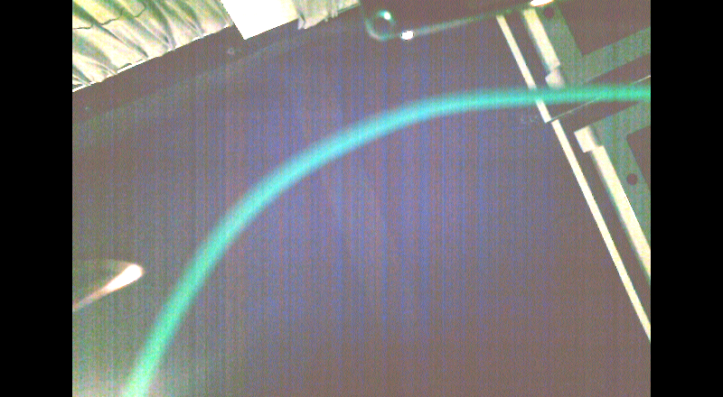
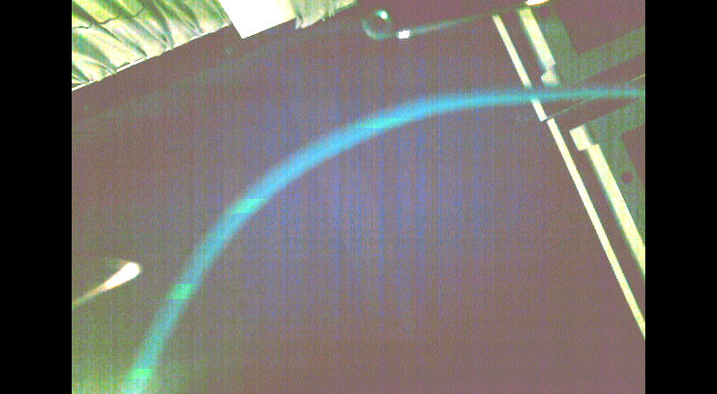
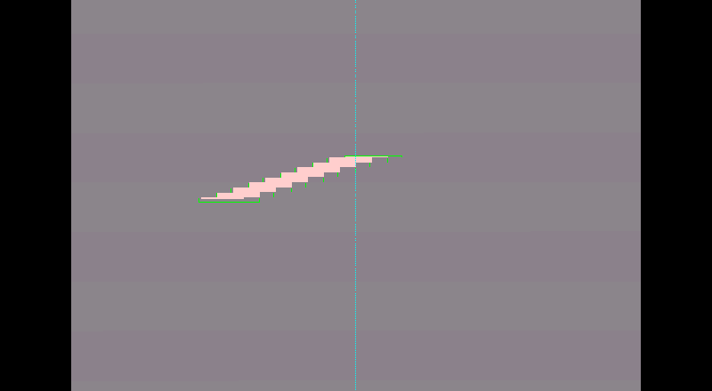
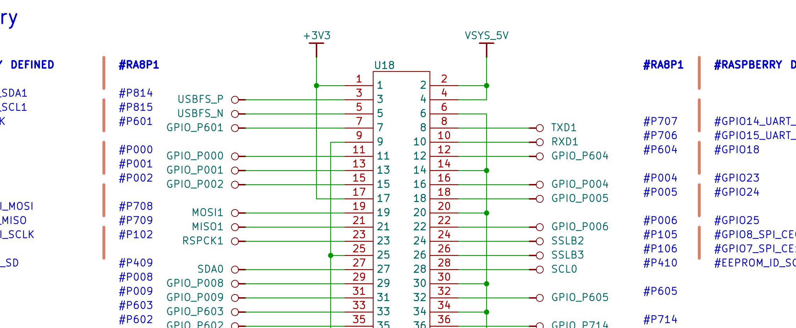
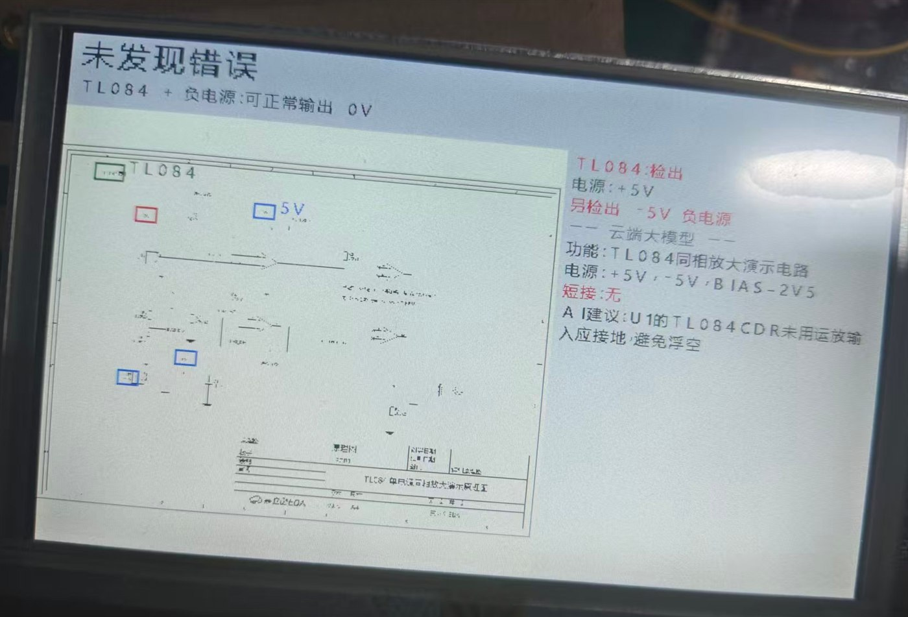
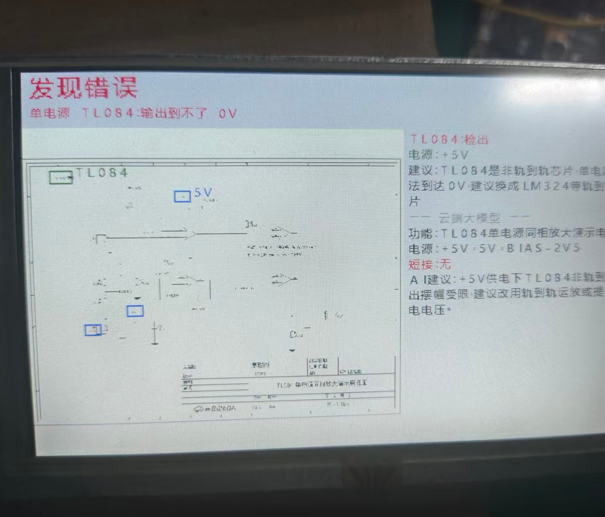
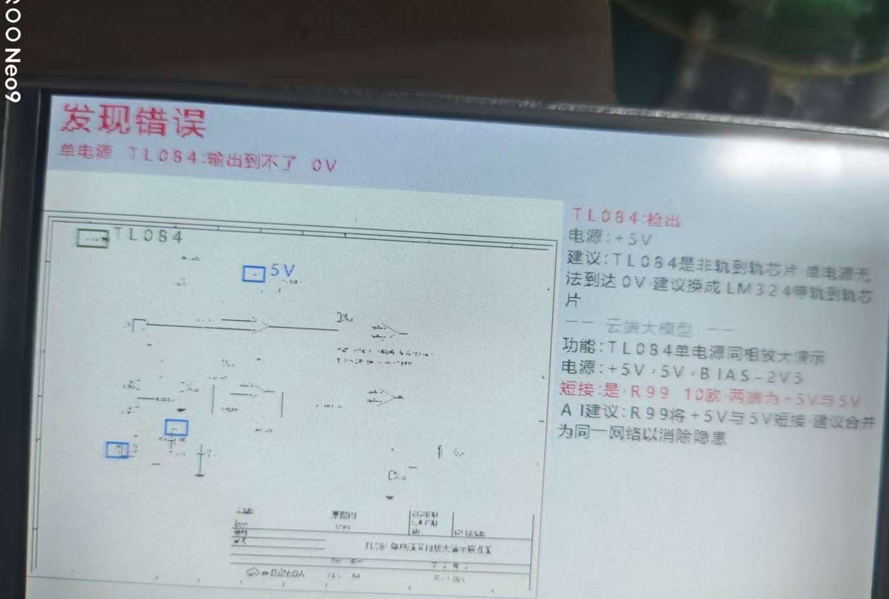
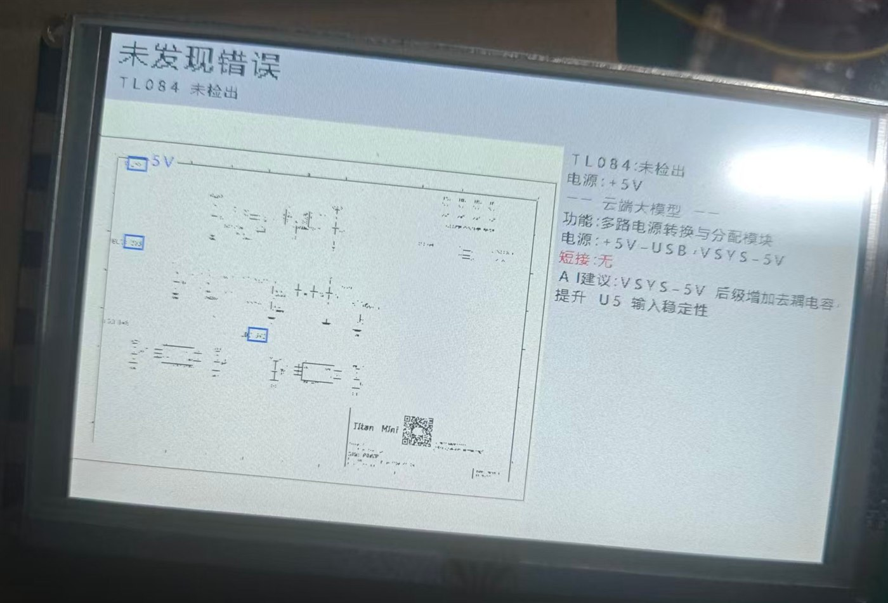

# 让一块 MCU 板自己「看板子」

**Titan Board Mini（RA8P1）双屏走查设备：六个坑与三个决定**

> 2026 RT-Thread 嵌入式大赛参赛作品 · 工程复盘

我们把「看实物焊盘、看原理图、给改进建议」这三件原本要人凑近了干的活，做成了一台能脱离 PC 自洽运行的设备：摄像头看实物、串口屏做交互、LCD 出画面、NPU 做本地判断、以太网接云端大模型。**有网走云，断网走离线规则，两种状态下都给出结论。**

跑通之后回头看，最费时间的不是模型，而是几条**手册上不会写、却决定成败的物理事实**。这篇尽量只写对别人有用的部分。

| 项目 | 内容 |
|---|---|
| 平台 | Titan Board Mini · R7KA8P1KFLC（Cortex-M85 + Ethos-U55-256，SDRAM 32 MB） |
| 视频链路 | OV5640 → GLCDC → 800×480 LCD |
| 交互 | 串口屏（UART1）+ 自定义行协议；console 在 UART2（FinSH） |
| 本地推理 | int8 + Vela：模型 162.1 KB，arena 280,928 B |
| 云端 | 以太网 → 路由器 → 大模型 API |
| 验收口径 | `ack ≥ cmd` 且 `err = 0`，而不是「看起来对」 |
| 适合谁读 | 用 MCU 做视觉 / 双屏 / 端侧 AI 的同行，尤其是被「板子不听话」卡住的人 |

---

## 1. 问题：两类「费眼的活」

硬件工程师日常有两件事很费眼：

- **看实物板**——焊盘有没有上锡、元件有没有缺件、位置对不对；
- **看原理图**——供电对不对、网络名有没有接错、标注有没有漏。

这两件事的结论都不难，难在**逐点核对**；而且结论一旦要「给建议」，还得有人在旁边解释。于是我们的目标很朴素：让板子自己看完、自己判断、自己说人话。

难点不在算法。**难在传感器、显示、总线这三层各有各的脾气**，而它们会联手把一个正确设计的设备拆得看起来像坏的。

---

## 2. 形态：一块板、两块屏


*图 1｜整机数据通路。注意底部那条虚线：断网时建议绕开云端，但界面并不知道来源变了——这是刻意的。*

双屏最容易犯的错是「两块屏都能显示，于是两块屏都显示」。我们把它写成契约：

| 屏 | 只干这些 | 绝不干这些 |
|---|---|---|
| LCD 800×480 | 实时画面、检测框、状态栏指标、日志框 | 不放菜单（挡住细节，没法看） |
| 串口屏 | 四个模式键、结论、建议全文、历史 | 不画视频（带宽不够） |

> **可迁移的一点**：双屏产品第一步不是画界面，而是写这张职责表。它同时约束了 UI、代码分层和用户注意力——后期所有「这个该显示在哪」的争论，都能拿它一句话结束。

---

## 3. 四个模式：一条主菜单走完

| 模式 | 干什么 | 实测 |
|---|---|---|
| 相机 | 实时画面 + 显示侧调色/增益 | 19.7 fps，端到端 39 ms，亮度 116，G/R 1.005 |
| 原理图 | 读图纸 → 走查 → 结论上屏 | 1787×1269 缩放至 782×556，verdict=2，1078 次填充 |
| 加载 | 图纸/模型推进设备缓存 | 39 条面板指令完成 |
| 检查 | 运动检测框选 + 拍照回传 PC | 20 fps / 单帧 3.8 ms；抓拍 230,400 B |

### 相机：画面在，指标也在



*图 2｜LCD 实拍。截图裁掉了顶部约 40 px 的状态栏——原因见第 7 节，不是忘了截。*

### 检查：空场景不误框，是真的不误框



*图 3｜空场景连续 12 秒、4 次采样，`area=0`。运动检测最容易死在「静态画面里永远有个框」上。*



*图 4｜用合成画面做帧差注入：条纹进入后 `trk=1` 且框包住目标，离开后回 0。合成图的好处是可复现，不受现场光照影响。*

### 拍照：PC 收到的就是当时那一帧


*图 5｜PC 端解码结果，320×240 RGB888，230,400 B。桌面上的排线清晰可辨——这才叫「链路通了」。*

### 原理图：被走查的对象长这样



*图 6｜U18 排针与 RA8P1 网络名的对照关系，就是规则引擎要判的东西。*

> **一个容易忽略的取证问题**：串口屏的界面**不在** LCD 帧缓冲里。双屏产品必须准备两条独立取证链路，别拿一块屏的截图去证明另一块屏——这一条我们吃过亏。

---

## 4. 六个坑：要是早知道就好了

### 坑 1｜背光调不了：这块板的 FSP 里没有 PWM

- **现象**：`rt_device_find("pwm7")` 返回 `NULL`，背光起不来，屏幕全黑。
- **第一反应（错的）**：以为设备名写错、或 PWM 驱动没开，去翻 `rtconfig.h` 找 `BSP_USING_PWM7`。
- **真因**：这块板的 FSP 配置里**根本没有 PWM 实例**。没有实例，驱动再怎么开也找不到设备。
- **做法**：把 `LCD_BL`（**P303**）当普通 GPIO 拉高，改在 `libraries\HAL_Drivers\drv_lcd.c`。亮度只能在显示侧做增益。
- **可迁移**：`rt_device_find()` 返回 `NULL` 时，第一件事是查**硬件实例有没有生成**，而不是查软件开关。

### 坑 2｜摄像头一改曝光，视频流就冻死

- **现象**：调 AEC、调手动曝光、调手动增益——**三个都试过，三个都冻**。画面停在最后一帧。
- **第一反应（错的）**：以为是寄存器时序没对齐，加延时、重初始化、换 I²C 速率。
- **真因**：这块 sensor 的 AEC/增益路径与我们的取流节奏不兼容，改参数会让输出停摆。
- **做法**：**彻底放弃在摄像头侧做图像处理**，全部下沉到显示链路：

```c
GAIN_R16 = 38;  GAIN_G16 = 32;  GAIN_B16 = 33;   /* 亮部 G/R: 1.32 → 1.005 */
DISP_GAIN16 = 32;                                 /* 2.0×，亮度 50.7 → 116 */
```

铁律一条：**模型吃原图，送屏前提亮**。两条路各走各的，绝不互相污染。
- **可迁移**：传感器不听话时，别死磕传感器——把处理搬到下游。下游的代价是带宽，上游的代价是不可控。

### 坑 3｜换个工程编译，开机就断言

- **现象**：从官方 NPU demo 切回本项目，编译通过、烧写成功，**开机直接断言**。
- **第一反应（错的）**：怀疑新加的代码有 bug，开始二分注释。
- **真因**：`libraries\**\*.o` 是**就地编译、多工程共用**的。上一个工程的目标文件带着不同的结构体布局躺在那里，链接进来就是内存错位。
- **做法**：换工程前先删 `libraries` 下所有 `.o` 和目标工程的 `build\`，再全量重编。
- **可迁移**：共享中间产物的构建系统，**"clean" 不是洁癖，是正确性**。

### 坑 4｜底部一条接缝：不是没同步，是抢带宽

- **现象**：画面底部出现一条横向错位/接缝。
- **第一反应（错的）**：以为缺垂直同步，去加 `vsync` 等待、加延时。
- **真因**：**总线争用**——CPU 正在合成的那块缓冲，和 GLCDC 正在扫描的那块，抢同一份内存带宽和缓存。
- **做法**：三缓冲。单缓冲会撕裂，双缓冲会接缝，三缓冲后消失。
- **可迁移**：撕裂/接缝先怀疑**带宽与缓冲所有权**，再怀疑同步信号。加 `vsync` 只能让错位变得"整齐"，不会让它消失。

### 坑 5｜三缓冲之后，画面还是一顿一顿

- **现象**：帧率够了，但肉眼能看出节奏不匀。
- **第一反应（错的）**：以为还是缓冲问题，继续加到四缓冲。
- **真因**：送屏节奏**跟着相机来帧走**，相机本身不均匀，抖动就被原样传导到屏幕。
- **做法**：改成**固定节拍送屏**（均匀节奏），抖动消失。
- **可迁移**：帧率是"平均"，节奏是"方差"。显示类设备两个都要管。

### 坑 6｜拍照一按，整个界面卡住

- **现象**：按拍照，面板不动了；拍照中按 BACK 直接卡死。
- **真因（两个）**：① 拍照逻辑跑在队列线程里，阻塞了它；② 拍照与 BACK 抢同一把锁。
- **做法**：
  - 拍照搬到独立线程 `photo_thread`，动作 0.8 s 返回；
  - 加 `g_photo_busy` 保护，拍照中按 BACK 最多等 8 s；
  - 相机切换后首帧可能几秒才到，**重试 5 次**。

最恶劣顺序 `MOTION → PHOTO → SNAP → BACK` 实测 4.3 s 内完成。
- **可迁移**：**任何"等硬件"的动作都不该跑在业务线程里**。慢不可怕，卡才可怕。

### 顺带一个：DAVE2D 没有字体 API

全 SDK 检索 `d2_rendertext` / `d2_selectfont`，**没有结果**。所以中文是我们自绘点阵 blitter + GB2312 字库画的；ASCII 用 8×16 点阵，只占 1.5 KB。

- **可迁移**：2D 加速库常常只给你"画形状"，不给你"排字"。**字库和排版要自己带**。

---

## 5. 三个架构决定

### 决定一：双屏分工写死成契约

见第 2 节的那张表。它不只是 UI 决定，还决定了代码分层：模式调度不碰渲染，渲染不碰业务。

### 决定二：云 / 离线收敛到一个接口


*图 7｜四态：CLOUD / LOCAL / RECOVER，外加每 30 s 的心跳探测。*

```c
int advice_get(int defect_type, const void *img, char *out_text, size_t cap);
```

云端实现一份、本地规则实现一份，**串口屏永远不知道建议来自哪里**。带来的好处是直接的：

- 界面不用做两套；
- 测试只测一个接口；
- 换云厂商 = 换一个实现文件，不动上层。

判据也要写实：**不是 ping 通**，而是 DHCP 拿到 IP + DNS 解析成功 + 一次小请求返回 200，三件事同时成立才算「有网」；降级要**连续 3 次失败**才动，避免路由器重启被误判成断网；恢复后**先补传队列**，再改 UI。

### 决定三：验收用计数，不用眼睛

面板交互我们自己定了一个硬口径：

```
cmd = 发出的指令数    ack = 面板回的接受数    err = 面板报的错数
判据：ack ≥ cmd  且  err = 0
```

端到端一轮压测：`cmd=3102 / ack=3153 / err=0`。

> **这一条最值得抄**。有了计数，你才能区分"我觉得显示对了"和"设备确认它收到了"——而这在双屏、远程、无人值守的场景里，是唯一能落地的判据。

---

## 6. 数据总表

| 项目 | 数字 |
|---|---|
| 相机帧率 / 端到端延迟 | 19.7 fps / 39 ms |
| 亮度 / 白平衡 | luma 116；G/R 1.005（修前 50.7 / 1.32） |
| 运动检测 | 20 fps，单帧 3.8 ms；空场景 12 s 无误框 |
| 原理图渲染 | 1787×1269 → 782×556，verdict=2，fill 1078 |
| NPU | int8 + Vela，模型 162.1 KB，arena 280,928 B |
| 抓拍 | 230,400 B（320×240×3 RGB888） |
| 面板交互 | cmd=3102 / ack=3153 / err=0 |
| 固件 | 966,656 B / 118 pages |

---

## 7. 局限：说清楚，比说漂亮有用

1. **面板版式未定稿。** 我们只验证到「每条绘图指令被面板接受」，**没有**验证到「文字对齐、不重叠」。本文图 2 顶部那 40 px 就是因为状态栏文字有重叠而裁掉的——截图是为了可读性，不是为了好看。
2. **缺件判定仍是二分类。** 当前是「焊盘 vs 绿油」，需要用真实产线数据重训，才谈得上可交付。
3. **云端建议依赖外部 API。** 网络质量直接决定建议时延，这一点在离线模式下才被消掉。
4. **规则是表驱动的 4 条。** 不是"任意原理图都能查"，字体/图源都有前提，异字体曾直接失败。

---

## 8. 可以直接抄走的清单

- [ ] **双屏先写职责契约表**，再画界面。
- [ ] **传感器不改，改下游**；下游只花带宽，上游要花不确定的时间。
- [ ] 换工程前**删共享 `.o` 与 `build\`**——clean 是正确性，不是洁癖。
- [ ] 撕裂 / 接缝先查**带宽与缓冲所有权**，再查 `vsync`。
- [ ] 帧率之外还要管**节奏（方差）**。
- [ ] **等硬件的活一律独立线程**，配 busy 标志与重试次数。
- [ ] 验收用 `cmd / ack / err` 这类**计数**，不用「看起来对」。
- [ ] 交付前先算内存账，再决定要不要说「本地大模型」。32 MB SDRAM 装不下 100M 参数 int8 权重（光权重就 100 MB）——我们对外一律写「离线专家规则」。
- [ ] 双屏取证要**两条独立链路**，别拿一块屏的截图证明另一块。

---

## 附录 A｜引脚与硬件事实

| 项 | 值 |
|---|---|
| 背光 | `LCD_BL` = **P303**，GPIO 拉高（无 PWM 实例） |
| 串口屏 | UART1：`TXD1 = P707`，`RXD1 = P706`，与板**必须共地** |
| console | UART2：`RT_CONSOLE_DEVICE_NAME "uart2"`（FinSH / msh） |
| 显示驱动 | `libraries\HAL_Drivers\drv_lcd.c`（GLCDC 800×480） |
| 供电 | 5 V / 3 A，输入电容 ≥ 470 µF（双屏 + 瞬时电流） |
| 烧写 | pyocd，target `r7ka8p1kf`；**探针不在线时会永久挂起** |

## 附录 B｜复现与取证

```powershell
# 编译（本机约定，不走 Studio 的 Ctrl+B）
powershell -NoProfile -ExecutionPolicy Bypass -File D:\RTT\build.ps1 -Project <工程名>
```

三个取证土办法，比拍照靠谱：

1. **屏幕取证**：直接读帧缓冲当截图。`fb_background` 地址**随工程变化**，必须从 elf 现取（`arm-none-eabi-nm`），不可写死。
2. **验收计数**：`cmd / ack / err`，见决定三。
3. **板内探针**：`g_panel_* / g_sch_* / g_ai_* / g_photo_* / g_stage / mode_*`，SWD 直读，不占串口。

---

> 如果这篇能帮你少踩一个坑，欢迎在评论区问细节。
> 尤其是「背光没有 PWM、只能当 GPIO 拉高」和「改曝光就冻结」这两条——第一次遇到的人，基本都会在同一个地方卡住半天。

---

## 补遗｜另一块屏：串口屏上到底显示了什么

前面所有配图都来自 LCD 帧缓冲——**串口屏在另一条链路上，一张都没拍到**。这里补五张实拍（手机拍摄，已裁去机身、水印与播放控件），把这台设备「下结论」的那一面补齐。


*图 8｜串口屏界面：左侧五个区块标签，右上角常驻指标，左下角回主菜单。*

界面是「标签 + 内容」两列结构，左侧五个区块：

| 标签 | 含义 |
|---|---|
| `RULE` | 走查结论（判定 + 触发原因） |
| `AI deepseek-flash` | 云端大模型给的建议正文 |
| `FUNC` | 识别出的电路功能 |
| `PWR` | 电源轨（+5V / −5V / BIAS） |
| `SHORT` | 短接检测结果 |
| `ADV` | 进阶建议 |

右上角常驻 `fps 19.7 / age 35 ms / luma / R/G`，和 LCD 状态栏是同一组指标——**两块屏读的是同一份数据**，这也是「双屏职责分离」能成立的前提。

### 同一个 TL084 电路，三种结论

| 图 | 顶部判定 | 触发条件 | 设备给的结论 |
|---|---|---|---|
| 图 10 | 未发现错误 | 有 −5V 负电源，可正常输出 0V | 未用运放输入应接地，避免浮空 |
| 图 11 | **发现错误** | 只有 +5V 单电源，输出到不了 0V | 非轨到轨，建议换 LM324 等轨到轨芯片，或提供负电源 |
| 图 12 | **发现错误** | R99（10 Ω）把 +5V 与 −5V 连在一起 | 合并为同一网络，消除隐患 |



*图 10｜TL084 + 负电源：可正常输出 0V（同一电路的正例）。*



*图 11｜只有 +5V 时输出到不了 0V——这条正是「非轨到轨」规则在起作用。*



*图 12｜红色那行「短接: 是 R99 10欧」——两条规则同时命中：既非轨到轨，又短接。*

### 另一张图：什么都没检出来



*图 9｜另一张图纸（多路电源转换模块），TL084 未检出，建议后级加去耦电容。*

### 三件值得说的事

**1.「未检出」和「通过」在界面顶部长得一模一样。**
图 9 的主标题是「未发现错误」，副标题才是「TL084 未检出」。前者意思是「这张图里没有我认识的器件」，后者是「有器件，且规则全过」。**用户只会看主标题那个绿字，就会以为查过了。** 这是我们下一步要改的：主标题应分三级——未检出 / 通过 / 不通过，而不是把两件事压成一句「未发现错误」。

**2. 规则是会叠加的。**
图 12 同时命中了「非轨到轨」和「短接」两条，界面靠行序 + 颜色把「最要紧的先说」表达出来（红色的 短接 在建议之前）。这比只报一条更有用——**真实电路的毛病从来不是单发的。**

**3. 长句会顶到屏幕边缘。**
图 8 的 AI 建议是连续长句，一行顶到右侧就断了，没有自动折行。短句（图 11、图 12 的规则文案）都排得开，问题只出在「云端返回的自由文本」上。这条也顺手回答了原文里「面板版式未验收」的那一句：**现在能看出版式的问题是「缺折行」，不是「排不下」。**
